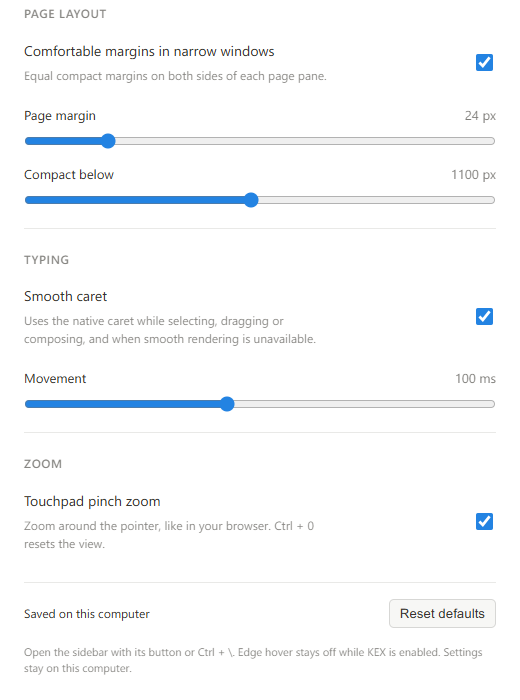

  

<h1 align="center">Notion KEX</h1>

  <em>The Notion desktop app with room to work, a smooth caret and touchpad pinch zoom.</em>

  
  &nbsp;
  
  &nbsp;
  

Notion KEX is the official Notion desktop app with extra features built in: slim page margins in narrow windows, a smooth caret, touchpad pinch zoom and more. It runs inside your installed Notion, with its own page in Notion's menus. Your pages, workspaces and settings keep working, and every feature can be switched off.

<a href="#features">Features</a> · <a href="#see-it-in-action">See it in action</a> · <a href="#install">Install</a> · <a href="CHANGELOG.md">Patch notes</a> · <a href="#faq">FAQ</a> · <a href="#licence">Licence</a>

## Features

- **Room to work**: in half-screen and narrow windows, pages get a slim, even margin on both sides instead of a narrow column in the middle. Wide windows keep Notion's own layout.
- **Adjustable margins**: set the margin and the window width where slim margins start.
- **Columns that fit**: two, three and five column layouts use the same width as the rest of the page. Column ratios and nested columns stay as you made them.
- **Full-width blocks**: tabs, headings, lists, quotes, callouts and code blocks fill the page. Covers, images and side panels keep their own sizes.
- **Smooth caret**: the caret glides to where you type or click, then blinks. Selecting, dragging and IME typing use Notion's own caret.
- **Touchpad pinch zoom**: pinch with two fingers to zoom around the pointer, from 100% to 500%. Pinch back or press <kbd>Ctrl</kbd>+<kbd>0</kbd> to reset. <kbd>Ctrl</kbd>+<kbd>+</kbd>/<kbd>−</kbd> still work.
- **No edge-hover sidebar**: the floating sidebar stays shut when the pointer touches the window edge. <kbd>Ctrl</kbd>+<kbd>\</kbd> and the sidebar button still open it.
- **Survives Notion updates**: after Notion updates itself, KEX repairs pinch zoom the next time Notion fully closes. It never closes Notion for you.
- **Your shortcuts keep working**: the taskbar pin, Start menu and desktop shortcuts open Notion through KEX, with Notion's own icon and taskbar group.
- **One file**: `Notion KEX.exe` installs, updates and uninstalls. No admin rights, PowerShell, Node.js or browser needed.
- **On/off switches**: one per feature and one for all of KEX, in Notion's *View* > *Extensions* menu.
- **Private**: KEX never changes your text or intercepts typing, and makes no network requests. Settings stay on your computer.

## See it in action

### Room to work

Notion's own margins in a half-screen window, then KEX, twice. The same sentence fits on one line.

### Smooth caret

### Settings

Press <kbd>Alt</kbd> in the Notion window to show its menu bar, then *View* > *Extensions* > *Notion KEX*. It has a switch for every feature, the margin, the width where slim margins start and the caret's speed.

## Install

Requires the Notion desktop app on 64-bit Windows 10 or 11.

1. Download `Notion KEX.exe` from the [latest release](https://github.com/SirBarnaby/notion-kex/releases/latest).
2. Quit Notion: right-click its icon in the notification area > **Quit**.
3. Run `Notion KEX.exe` and click **OK**. Notion opens when it's done.
4. Once only: in the Notion window, press <kbd>Alt</kbd> > *Debug* > tick **Extensions Enabled**, then quit Notion and open it again.

To update, run the new `Notion KEX.exe` the same way. Your settings are kept.

> [!NOTE]
> The file isn't code-signed, so Windows may show an "unknown publisher" warning (*More info* > *Run anyway*). The *Debug* menu is Notion's own application menu, not a page's or workspace's menu.

### Uninstall

Quit Notion, then run `"%LOCALAPPDATA%\NotionKEX\Notion KEX.exe" uninstall`. It puts back Notion's original app files and shortcuts. Your pages, other extensions and Notion settings are untouched.

## FAQ

**What happens when Notion releases a new version?**  
Notion updates itself as usual. Margins, the caret and your settings keep working straight away. Pinch zoom comes back the next time Notion fully closes, when KEX repairs it. KEX checks the new version first; if it doesn't recognise it, it leaves Notion alone and Notion keeps its native look.

**Does it change Notion.exe?**  
No. Notion.exe, its updater and its secure settings are never touched. Pinch zoom adds two small scripts to Notion's app archive, after a backup that uninstall puts back. Builds of Notion that lock their app archive are refused rather than worked around.

**Why the *Debug* > *Extensions Enabled* step?**  
Extensions in the Notion desktop app need Notion's own permission switch, and it's stored encrypted on each computer. KEX shows the menu, but the click has to be yours.

**Can my Notion account get in trouble?**  
KEX doesn't talk to Notion's servers or automate anything. It only changes how the desktop app draws pages on your computer.

**Does it work in the browser or on macOS?**  
No, only in the Notion desktop app for Windows.

**Is this an official Notion release?**  
No. It isn't affiliated with or endorsed by Notion Labs, Inc. Notion is a trademark of Notion Labs, Inc.

Bug reports and ideas go in [Issues](https://github.com/SirBarnaby/notion-kex/issues). To build it yourself, see [`native-host/README.md`](native-host/README.md).

## Licence

MIT (see [LICENSE](LICENSE)).
