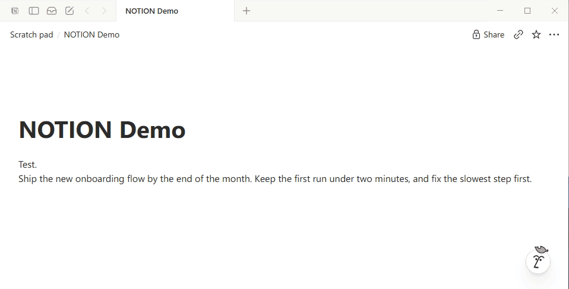
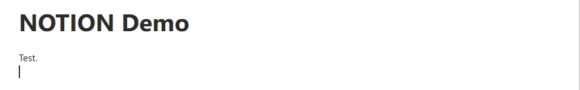

<p align="center">
  
</p>

<h1 align="center">Notion KEX</h1>

<p align="center">
  <em>The Notion desktop app with room to work, a smooth caret and touchpad pinch zoom.</em>
</p>

<p align="center">
  <a href="https://github.com/SirBarnaby/notion-kex/releases/latest"></a>
  &nbsp;
  
  &nbsp;
  <a href="LICENSE"></a>
</p>

Notion KEX makes the official Notion desktop app for Windows better at the window sizes you actually use. Pages stop wasting half the screen on empty margins, the caret glides instead of jumping, and two fingers on the touchpad zoom like in a browser. It lives inside the real Notion app, with its own page in Notion's menus, and every feature can be switched off.

<p align="center"><sub><a href="#features">Features</a> · <a href="#see-it-in-action">See it in action</a> · <a href="#install">Install</a> · <a href="CHANGELOG.md">Patch notes</a> · <a href="#faq">FAQ</a> · <a href="#licence">Licence</a></sub></p>

## Features

- **Room to work**: in narrow and half-screen windows, pages use a slim, even margin on both sides instead of a narrow column in the middle. Wide windows keep Notion's own layout.
- **Adjustable margins**: pick the margin and the window width where compact margins start.
- **Columns that fit**: two, three and five column layouts use the same compact width. Column ratios and nested columns stay as you made them.
- **Full-width blocks**: tabs, headings, lists, quotes, callouts and code blocks fill the page. Covers, images and side panels keep their native sizes.
- **Smooth caret**: the caret glides to where you type or click, then blinks like the native one. Selecting, dragging and IME typing use Notion's own caret.
- **Touchpad pinch zoom**: pinch with two fingers to zoom around the pointer, from 100% to 500%. Pinch back or press <kbd>Ctrl</kbd>+<kbd>0</kbd> to reset. <kbd>Ctrl</kbd>+<kbd>+</kbd>/<kbd>−</kbd> still work.
- **No edge-hover sidebar**: the floating sidebar no longer pops out when the pointer touches the window edge. <kbd>Ctrl</kbd>+<kbd>\\</kbd> and the sidebar button still open it.
- **Settings inside Notion**: *View* > *Extensions* > *Notion KEX*, with a switch for each feature and one to turn KEX off.
- **Survives Notion updates**: the Notion KEX launcher checks itself every time Notion starts and repairs pinch zoom after an app update, the next time Notion fully closes. It never closes Notion for you.
- **Your shortcuts keep working**: the taskbar pin, Start menu and desktop shortcuts keep Notion's icon and taskbar group.
- **One file, no installer**: `Notion KEX.exe` is the installer, the launcher and the uninstaller. No admin rights, PowerShell, Node.js or browser needed.
- **Private by design**: KEX never changes your text, never intercepts typing and makes no network requests. Settings stay on your computer.

## See it in action

### Room to work

<p align="center"></p>

### Smooth caret

<p align="center"></p>

### Touchpad pinch zoom

<p align="center"></p>

### Settings

<p align="center"></p>

## Install

Requires the official Notion desktop app on 64-bit Windows 10 or 11.

1. Download `Notion KEX.exe` from the [latest release](https://github.com/SirBarnaby/notion-kex/releases/latest).
2. Quit Notion completely: right-click its icon in the notification area and choose **Quit**.
3. Run `Notion KEX.exe` and choose **OK**. Notion opens when it's done.
4. One time only, turn on Notion's extension permission: click into the Notion window, press and release <kbd>Alt</kbd>, then choose **Debug** > **Extensions Enabled**. Quit Notion from the tray and open it again.

That's it. Open *View* > *Extensions* > *Notion KEX* to change the settings.

> [!NOTE]
> The file isn't code-signed, so Windows SmartScreen may say it's from an unknown publisher. Choose *More info* > *Run anyway*. The *Debug* menu is Notion's own application menu, not a page or workspace menu.

### Update

Download the new `Notion KEX.exe` and run it. Your settings are kept.

### Uninstall

Quit Notion, open a terminal and run:

```bash
"%LOCALAPPDATA%\NotionKEX\Notion KEX.exe" uninstall
```

It puts Notion's original app files and shortcuts back and removes KEX. Your notes, other extensions and Notion settings are untouched.

## FAQ

<details>
<summary><b>Will this get my Notion account in trouble?</b></summary>

KEX doesn't talk to Notion's servers, change what gets synced or automate anything. It only changes how the desktop app draws pages on your computer.
</details>

<details>
<summary><b>What happens when Notion updates itself?</b></summary>

Margins, the caret and settings keep working straight away. Pinch zoom returns the next time Notion fully closes: KEX waits for Notion and its updater to finish, then repairs it. You can also just run `Notion KEX.exe` again.
</details>

<details>
<summary><b>Does it change Notion.exe?</b></summary>

No. Notion.exe, its update system and its secure settings are never touched. Pinch zoom adds two small scripts to Notion's own app archive, after checking that the archive is one KEX understands. The original is backed up first and restored on uninstall. Builds of Notion that lock their app archive are refused rather than worked around.
</details>

<details>
<summary><b>Why does it need the Debug menu step?</b></summary>

Extensions in the Notion desktop app need Notion's own permission switch, and that switch is stored encrypted on each computer. KEX turns on the menu, but the click has to be yours.
</details>

<details>
<summary><b>Does it work in the browser or on macOS?</b></summary>

No. Notion KEX is for the Windows desktop app only.
</details>

<details>
<summary><b>Something looks wrong. How do I check?</b></summary>

Run `"%LOCALAPPDATA%\NotionKEX\Notion KEX.exe" status` in a terminal. If Notion redesigns something KEX doesn't recognise, KEX steps aside and Notion keeps its native look until KEX is updated. Please [open an issue](https://github.com/SirBarnaby/notion-kex/issues) with what you see.
</details>

## Building from source

See [`native-host/README.md`](native-host/README.md) for the launcher and its 83-case test suite, and [`docs/technical.md`](docs/technical.md) for how the extension and the pinch zoom patch work.

## Licence

[MIT](LICENSE). Notion KEX is not affiliated with or endorsed by Notion Labs, Inc. Notion is a trademark of Notion Labs, Inc.
