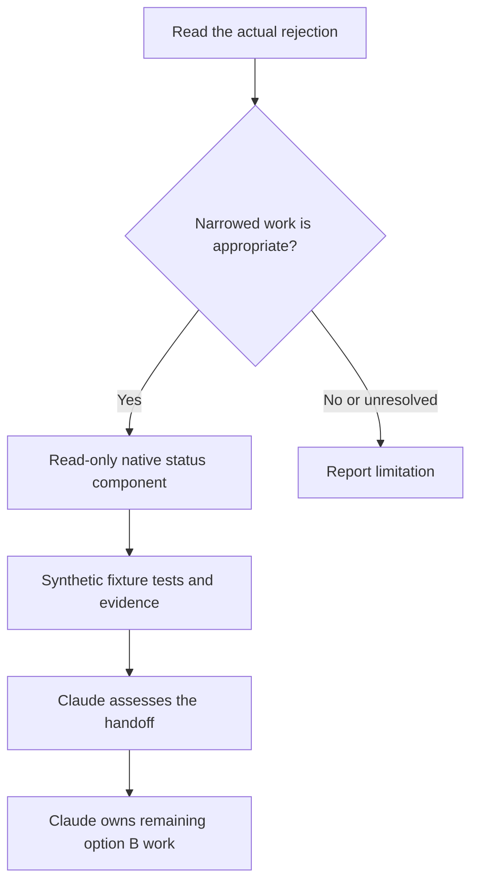

# Notion KEX Native Handoff - Plan

## Goal Capsule

Prepare the smallest independently useful native component and enough evidence for Claude to assess continuing option B itself.
Claude's acceptance is an external decision, not an engineering result we can guarantee.

The immediate deliverable is a read-only C++ status component with synthetic tests, subject to understanding the original rejection.
Claude retains the launcher, repair transaction, update integration, installer and release work.
This is one local change set; this directory is not a Git repository.
Stop before expanding the component into a complete replacement EXE.

---

## Product Contract

### Problem Frame

The user chose option B, a separate fully native `Notion KEX.exe`, in Claude's “Optimize Notion KEX and its update check” thread.
At 00:52 Europe/Tallinn on 9 November, Claude reported a safety check had stopped work before any launcher code was written.
The visible message gives no classifier category, rejected command, or detailed reason.
Consequently, there is currently no evidence establishing which component, if any, Codex must implement to make continuation possible.

### Verified Baseline

| Item | Evidence available on 9 November |
|---|---|
| Workspace | `package.json` and `extension/manifest.json`: KEX 1.1.2 |
| Installed app | Local Notion.exe ProductVersion: 7.42.1 |
| Installed extension | Local KEX install record: 1.1.1; record alone does not prove runtime activation |
| Native source | `native/` contains `pinch.js` and `pinch-main.js`; no C++ source |
| Existing launcher | `tools/Launch.ps1`: status, conditional repair, normal Notion launch |
| Existing repair | `tools/NativeZoom.ps1` and `tools/Asar.ps1` |
| Prior validation | Claude reports 64 Linux fixture checks passed for 1.1.2; not rerun in this planning task |

Claude's document recommends option A, but the later explicit selection is B and takes precedence.
Its “sign-in check” means Windows user logon, not inspecting Notion account credentials.

### Requirements

**Immediate handoff**

- R1. Determine the actual denied operation before claiming to know the minimum needed for continuation.
- R2. Limit any initial implementation to read-only status logic, exercised against generated fixture files.
- R3. Supply source, reproducible build instructions, test results and an honest description of remaining work.
- R4. Preserve the original stop and describe capabilities accurately; do not change Claude's safety settings or conceal the purpose of the code.

**Final product constraints retained for Claude**

- R5. Option B performs its production launch, detection and repair in native code without PowerShell.
- R6. Retain the existing backup, journal, hash, path, integrity-fuse and concurrent-change protections.
- R7. Preserve Notion's signed EXE and native windows, extension permission, shortcuts and taskbar integration.
- R8. Preserve the agreed lifecycle: never close Notion behind the user's back; the first session after an update may lack pinch until a full quit.

### Scope Boundaries

Codex's proposed first slice does not install anything, write app archives or profile settings, start Notion, register logon startup, modify shortcuts, add an update hook, or create a background watcher.
These are explicit scope limits on this handoff, not a redesign of option B.
Do not install 1.1.2 merely to prepare the native component: installation is independent work and Notion is currently running.

### Blocking Question

**Exact rejection unavailable.** Obtain the denied action and stated reason from the original Claude task's activity if exposed, or from the user if not.
The historical 20 October auto-mode debug-launch rejection in a different local session is not evidence of the 9 November C++ rejection.
If the missing reason cannot be obtained, return this limitation and seek Claude's assessment of the narrowed scope; do not present a completed component as having resolved its refusal.

---

## Planning Contract

### Key Technical Decisions

- KTD1. Start with status rather than a full native repair port (R1–R3). It is a small, useful boundary without the write transaction, process lifecycle and persistence features that require separate assessment. It may prove insufficient; do not expand automatically to manufacture acceptance.
- KTD2. Use the current PowerShell implementation as the behavioral reference, preserving its on-disk record formats (R6). Separate passive inspection from recovery: the existing `Status` action can recover a pending transaction and therefore is not a read-only oracle in interruption cases.
- KTD3. Build a reusable C++ component and a fixture test executable (R2), not a finished production launcher. The test executable requires explicit fixture paths and has no automatic live-profile discovery.
- KTD4. Keep the tests outside the portable package (R3). `tools/Build.ps1` currently packages every file under `native/`, `tools/` and `docs/`; placing experimental source there would unintentionally ship it. Put proposed source and instructions under a new `native-host/` directory, with tests under `test/`.

### High-Level Technical Design

### Assumptions and Limits

The read-only boundary is an engineering recommendation, not a claim about why Claude stopped.
No source or test has yet been written for this proposal.
File size and modification time can support a future performance cache, but are not equivalent to verified content hashes.
The future updater watcher must distinguish the updater's temporary process gap from the final user quit; waiting for a single Notion PID to exit does not establish a safe repair window.
Wine checks cannot prove Windows taskbar grouping, logon behavior, real updater races, or physical touchpad behavior.

---

## Implementation Units

### U1. Establish the rejection and freeze the boundary

**Requirements:** R1, R4. **Dependencies:** none.

**Files:** evidence note under `native-host/README.md`, if proceeding.

Read the original denied operation without retrying it.
Separate a host permission denial from a model refusal or a concern about the proposed program's behavior.
Record what is known and unknown, and assess whether U2 addresses a real concern.
Do not edit permission rules, disable checks, or delegate the denied operation under a different description.

**Verification:** the handoff can explain the rejection precisely, or explicitly records that it remains unknown. If it prohibits the proposed slice too, stop before U2.
**Test expectation:** none; this unit gathers evidence and sets scope.

### U2. Add the smallest passive native component

**Requirements:** R2, R6. **Dependencies:** U1 has established a permissible boundary.

**Files:** proposed `native-host/CMakeLists.txt`, `native-host/status.cpp`, `native-host/status.hpp`, `test/native-host-status.cpp`.

Implement bounded metadata parsing, target-path validation, SHA-256 comparison and structured status results for explicit fixture paths.
Reuse a suitable maintained JSON library through a pinned dependency rather than inventing a parser; select it after the boundary is settled.
Return distinct results for current patch, no record, changed archive, invalid record and recovery required.
A pending journal is reported without recovery or cleanup.
No process launch, filesystem mutation, network calls, watcher or auto-start code belongs in this slice.

**Patterns:** `tools/NativeZoom.ps1` record validation and hash semantics; `test/installer-fixture.mjs` generated app format; `test/native-installer.ps1` interruption states.

**Test scenarios:**

1. Matching generated archive, backup and record produce the installed result.
2. Missing installation record reports absent without creating directories.
3. Replaced archive reports changed and preserves its bytes.
4. Malformed or oversized JSON, invalid hashes and out-of-root backup paths fail without writes.
5. A pending transaction reports recovery required before and after a simulated archive swap.
6. Missing or altered backup reports invalid recovery material.
7. Unicode paths, spaces and fixture reparse points receive the intended path handling.
8. Snapshot fixture bytes and directory contents before and after every case; status does not mutate them.

**Verification:** builds with a documented Windows C++ toolchain; generated-fixture tests pass on Windows. The seam proves passive status semantics, not repair or live Notion compatibility.

### U3. Package evidence and stop for handoff

**Requirements:** R3–R4. **Dependencies:** U2.

**Files:** `native-host/README.md`; generated evidence under `test-results/native-host-status.json`.

Document exact build and test commands, compiler/dependency versions, source hashes, fixture outcomes and absent capabilities.
State clearly that Claude's remaining work includes native repair parity, launch behavior, updater/logon integration, shortcuts, migration, rollback, packaging and Windows validation (R5–R8).
Give the user the handoff to review; do not send messages to Claude unless separately instructed.

**Verification:** another developer can reproduce the component from source; the release ZIP and live installation are untouched.
**Test expectation:** reuse U2's behavior tests and inspect the artifact inventory; no additional mirrored tests.

---

## Verification Contract

This planning task used read-only source, metadata and chat inspection; it did not run builds or tests.

The proposed slice needs its own reproducible CMake/CTest build and test commands once created.
Keep `npm test` as a regression gate if existing payloads or tooling change; the bounded slice should not need to change them.
Do not run `npm run build` for this handoff, because it replaces the release ZIP and regenerates checksums.

Before Claude eventually ships option B, port the existing archive, install, interruption-recovery and portable-install fixtures to its native implementation.
Run native lifecycle tests on Windows; reserve signed-in caret and physical pinch checks for the actual final installation.

---

## Definition of Done

The proposed first slice is done when U1–U3 have reproducible evidence, no unsupported safety-resolution claim is made, and no production integration has been added.
Remove abandoned experimental source from the deliverable.
Claude's willingness to continue must be reported only after Claude actually assesses the handoff.
If it declines again, preserve the reason and stop; the scope must not grow into a full implementation solely to get past that response.

---

## Sources and Research

- [Latest Claude thread](https://claude.ai/code/project/chan_01SQq3JuSDkCPTkoqYmvjvb3?thread=cmsg_01SQq3JuSDkCPTkoqYmvjvb35YNJZsvraZGoSVp71cKTD2), read 9 November 2026: option B selection, stopped task list, 00:52 stop message.
- [Claude design document](https://claude.ai/code/artifact/de502eb7-0303-4942-a6d0-140d3137407b): existing architecture, A/B/C comparison and agreed update limitation. Its recommendation predates the B selection.
- Local implementation and fixtures named above; `docs/research.md`, `docs/verification.md`, `package.json` and `tools/Build.ps1`.
- [Notion-enhancer official site](https://notion-enhancer.github.io/) still warns that Notion updates impaired it. Its [source repository](https://github.com/notion-enhancer/notion-enhancer) exists, but current desktop 7.42.1 compatibility and active maintenance were not established. It is not a verified replacement for this handoff.
- Focused GitHub, Reddit, Windhawk and Nexus searches found no verified ready-made native KEX status/repair replacement. Search absence does not prove none exists. Browser customization extensions do not establish support for desktop archive repair.

## Review Limits

The plan has been checked against the inspected source and thread for scope, mutation boundaries, packaging and test coverage.
No independent document-review skill runner is exposed in this host; the separate ce-doc-review workflow did not run.
The exact original rejection remains the prerequisite for claiming a continuation path.
